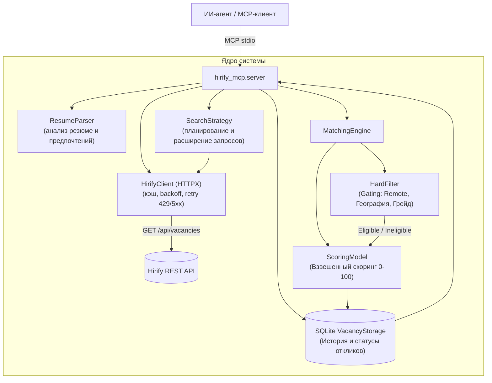

# Hirify MCP Server 🔍💼

[](https://github.com/VladMontana/hirify_mcp/actions/workflows/ci.yml)
[](https://www.python.org/downloads/)
[](https://modelcontextprotocol.io)
[](https://github.com/astral-sh/ruff)
[](https://mypy-lang.org/)

Production-grade MCP (Model Context Protocol) сервер для поиска и сопоставления вакансий с платформы [Hirify.me](https://hirify.me). Разработан специально для ИИ-агентов (Claude Desktop, Cursor, Antigravity, Windsurf), ищущих работу для кандидата с учётом технических навыков, грейда, географических ограничений и зарплатных ожиданий.

---

## 🏗 Архитектура системы

Сервер спроектирован по модульному принципу с чётким разделением ответственности:



---

## ✨ Возможности

1. 📄 **Анализ профиля (`parse_profile`)**:
   - Безопасное распознавание стека с защитой от ложных подстрок (`c++`, `c#`, `.net`, `go` vs `django`, `java` vs `javascript`, `react` vs `react native`).
   - Определение грейда кандидата с разделением текущего уровня и будущих амбиций (*"Ищу Junior, в будущем хочу стать Senior"* → определяется как `junior`).
   - Разделение коммерческого опыта и учебных/pet-проектов (*"Изучаю Python 3 года, коммерческого опыта нет"* → `junior`, а не `middle`).
   - Автоматическое извлечение зарплатных ожиданий, уровня английского, формата (`remote_only`) и страны нахождения.

2. 🛡 **Обязательная фильтрация (Hard Filters)**:
   - Проверка до расчёта совместимости: неподходящие вакансии отсеиваются сразу.
   - **Формат работы:** при требовании `remote only` офисные и гибридные вакансии исключаются.
   - **География:** валидация физической локации и разрешённых стран соискателя против `remote_restrictions`, `allowed_locations` и `ineligible_countries`.
   - **Грейд:** Junior-кандидату не предлагаются позиции Senior/Lead в строгом режиме.
   - **Зарплата:** проверка порога с учётом валют и периодов (час, месяц, год).
   - **Архив:** отсечение архивных и недействительных предложений.

3. 🎯 **Взвешенный Matching Engine (0–100 баллов)**:
   - **40 баллов** — Обязательные технические навыки.
   - **15 баллов** — Дополнительные и сопутствующие технологии.
   - **20 баллов** — Релевантность роли и специализации (`backend_dev`, `devops`, `qa_automation` и др.).
   - **15 баллов** — Соответствие грейда (`exact`, `close`, `mismatch`, `unknown`).
   - **10 баллов** — Условия и зарплатные предпочтения.
   - Полная объяснимость: плюсы, минусы, недостающие навыки, предупреждения и дисклеймер. Вакансии без указания требований не получают необоснованно завышенный балл.

4. 🔄 **Двухэтапная поисковая стратегия (`SearchStrategy`)**:
   - Автоматическая генерация запросов по приоритетам: фреймворки → языки → роли.
   - Умное расширение: если строгий поиск возвращает мало результатов, фильтр специализации API безопасно снимается, а ограничения кандидата перепроверяются локально.
   - Двухэтапный сбор: быстрый отбор по списку + опциональная догрузка полных описаний (`get_vacancy_details`) для лидеров топа.

5. 🗄 **Локальная история вакансий (SQLite)**:
   - Автоматическое отслеживание новых вакансий: агент различает ранее показанные и впервые обнаруженные (маркер `🆕`).
   - Сохранение статусов кандидатов: `new`, `viewed`, `saved`, `applied`, `interview`, `rejected`, `offer`, `archived`.
   - Пользовательские статусы и личные заметки сохраняются при повторных поисках.

6. 📝 **Контекст для отклика (`prepare_application_context`)**:
   - Структурированная подготовка фактов для сопроводительного письма (сильные стороны, совпадающие навыки, прямые ссылки).
   - **Безопасность:** текст вакансий обрабатывается исключительно как недоверенные данные; автоматическая отправка резюме запрещена.

---

## 📦 Установка

### Требования
- Python >= 3.11
- Менеджер пакетов [uv](https://github.com/astral-sh/uv) (рекомендуется) или стандартный `pip`.

### Установка через uv (рекомендуется)
```bash
git clone https://github.com/VladMontana/hirify_mcp.git
cd hirify_mcp
uv venv
uv pip install -e ".[dev]"
```

### Установка через pip
```bash
git clone https://github.com/VladMontana/hirify_mcp.git
cd hirify_mcp
python -m venv .venv
# Активация:
# Windows: .venv\Scripts\activate
# Linux/macOS: source .venv/bin/activate
pip install -e ".[dev]"
```

---

## 🔌 Подключение к MCP-клиентам

Сервер работает через стандартный протокол `stdio` (`hirify_mcp.server`). Все системные логи направляются в `stderr`, что гарантирует чистоту JSON-RPC потока.

### Claude Desktop
Отредактируйте файл конфигурации `claude_desktop_config.json`:

- **Windows:** `%APPDATA%\Claude\claude_desktop_config.json`
- **macOS:** `~/Library/Application Support/Claude/claude_desktop_config.json`
- **Linux:** `~/.config/Claude/claude_desktop_config.json`

```json
{
  "mcpServers": {
    "hirify": {
      "command": "uv",
      "args": [
        "--directory",
        "/absolute/path/to/hirify_mcp",
        "run",
        "hirify-mcp"
      ]
    }
  }
}
```

### Cursor / Antigravity / Windsurf
В настройках MCP добавьте сервер:
- **Name:** `hirify`
- **Type:** `command`
- **Command:** `uv`
- **Args:** `["--directory", "/absolute/path/to/hirify_mcp", "run", "hirify-mcp"]`

*(или напрямую через бинарник виртуального окружения: `python -m hirify_mcp.server`)*.

---

## 🛠 Доступные MCP-инструменты

| Инструмент | Параметры | Описание |
| :--- | :--- | :--- |
| `match_vacancies` | `profile_text`, `top_n=10`, `work_format=None`, `grade=None`, `min_score=40`, `candidate_country=None`, `strict_mode=True`, `min_salary=None`, `currency=None`, `fetch_details=False` | **Главный инструмент**: парсинг резюме, поиск, hard filters, скоринг и вывод рекомендаций с объяснениями. |
| `search_vacancies` | `query=None`, `grade=None`, `work_format=None`, `specialization=None`, `limit=15`, `page=1` | Прямой поиск по платформе Hirify с фильтрами. |
| `get_vacancy_details` | `vacancy_id` | Полное описание вакансии, требования и прямые ссылки на отклик. |
| `parse_profile` | `text` | Извлечение структурированного JSON-профиля соискателя из текста. |
| `get_new_vacancies` | `limit=20` | Получение списка впервые обнаруженных вакансий из локальной базы SQLite. |
| `save_vacancy` | `vacancy_id`, `status="saved"`, `notes=None` | Добавление вакансии в отслеживаемые или изменение статуса (`applied`, `interview` и т.д.). |
| `list_saved_vacancies` | `status=None`, `limit=50` | Просмотр списка отслеживаемых вакансий с фильтром по статусу. |
| `update_application_status` | `vacancy_id`, `status`, `notes=None` | Обновление этапа отклика и персональных заметок кандидата. |
| `prepare_application_context` | `vacancy_id`, `profile_text=None` | Подготовка контекста и аргументов для составления сопроводительного письма. |

---

## ⚙️ Конфигурация окружения

Параметры можно переопределять через переменные окружения:

| Переменная | По умолчанию | Описание |
| :--- | :--- | :--- |
| `HIRIFY_API_BASE_URL` | `https://api.hirify.me/api` | Базовый URL API Hirify |
| `HIRIFY_REQUEST_TIMEOUT` | `15.0` | Таймаут HTTP-запросов (секунды) |
| `HIRIFY_MAX_RETRIES` | `3` | Количество повторных попыток при 5xx/429 |
| `HIRIFY_RETRY_BACKOFF` | `0.5` | Коэффициент экспоненциальной задержки |
| `HIRIFY_RATE_LIMIT_DELAY` | `0.1` | Пауза между запросами к API (секунды) |
| `HIRIFY_CACHE_ENABLED` | `true` | Включение локального кэша ответов API |
| `HIRIFY_CACHE_TTL` | `300` | Время жизни кэша (секунды, 5 мин) |
| `HIRIFY_DB_PATH` | `hirify_history.db` | Путь к локальной базе данных SQLite |
| `HIRIFY_LOG_LEVEL` | `INFO` | Уровень логирования (`DEBUG`, `INFO`, `WARNING`) |

---

## 🧪 Запуск тестов и проверка качества

Проект полностью покрыт модульными, контрактными и интеграционными тестами.

### 1. Запуск offline unit-тестов (детерминированные, без сети):
```bash
pytest -m "not integration" -v
```

### 2. Запуск live интеграционных тестов (требуют доступа к API Hirify):
```bash
pytest -m integration -v
```

### 3. Запуск всех тестов:
```bash
pytest -v
```

### 4. Проверка линтером и форматированием (Ruff):
```bash
ruff check .
ruff format --check .
```

### 5. Проверка статической типизации (Mypy):
```bash
mypy src/hirify_mcp
```

---

## 🤖 Пример запроса для ИИ-агента

Скопируйте этот запрос вашему ИИ-ассистенту:

> *"Найди подходящие удалённые вакансии Junior Python Backend Developer с учётом моего опыта и технического стека (Python, FastAPI, PostgreSQL, Docker). Исключи вакансии, недоступные для работы из России, объясни каждую рекомендацию и покажи новые предложения."*

---

## 🔒 Безопасность и этичность

1. **Защита от Prompt Injection:** Описания вакансий и требования работодателей с платформы Hirify считаются внешними недоверенными данными и не исполняются как системные инструкции.
2. **Отсутствие авто-откликов:** Сервер **не** отправляет резюме и сообщения работодателям самостоятельно. Он готовит контекст и прямые ссылки, оставляя решение за пользователем.
3. **Приватность:** Локальная история поиска хранится на вашей машине в файле SQLite (`hirify_history.db`). Персональные данные резюме не отправляются на сторонние серверы.

---

## 📄 Лицензия

MIT License. См. файл `LICENSE` (если применимо).
